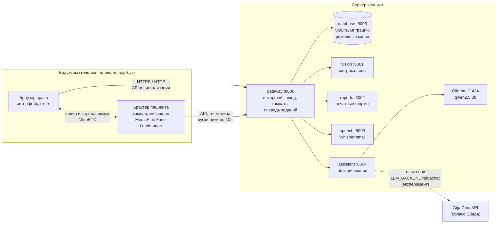
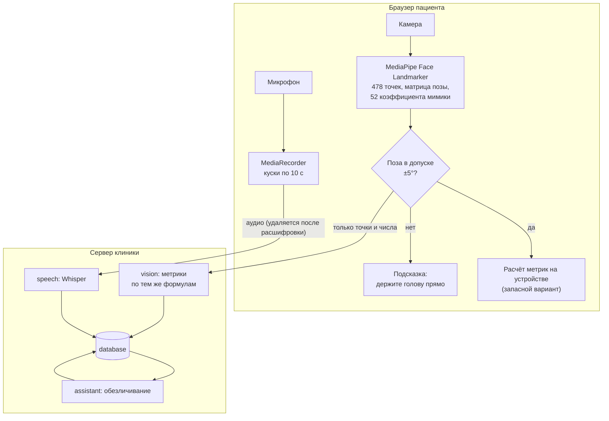
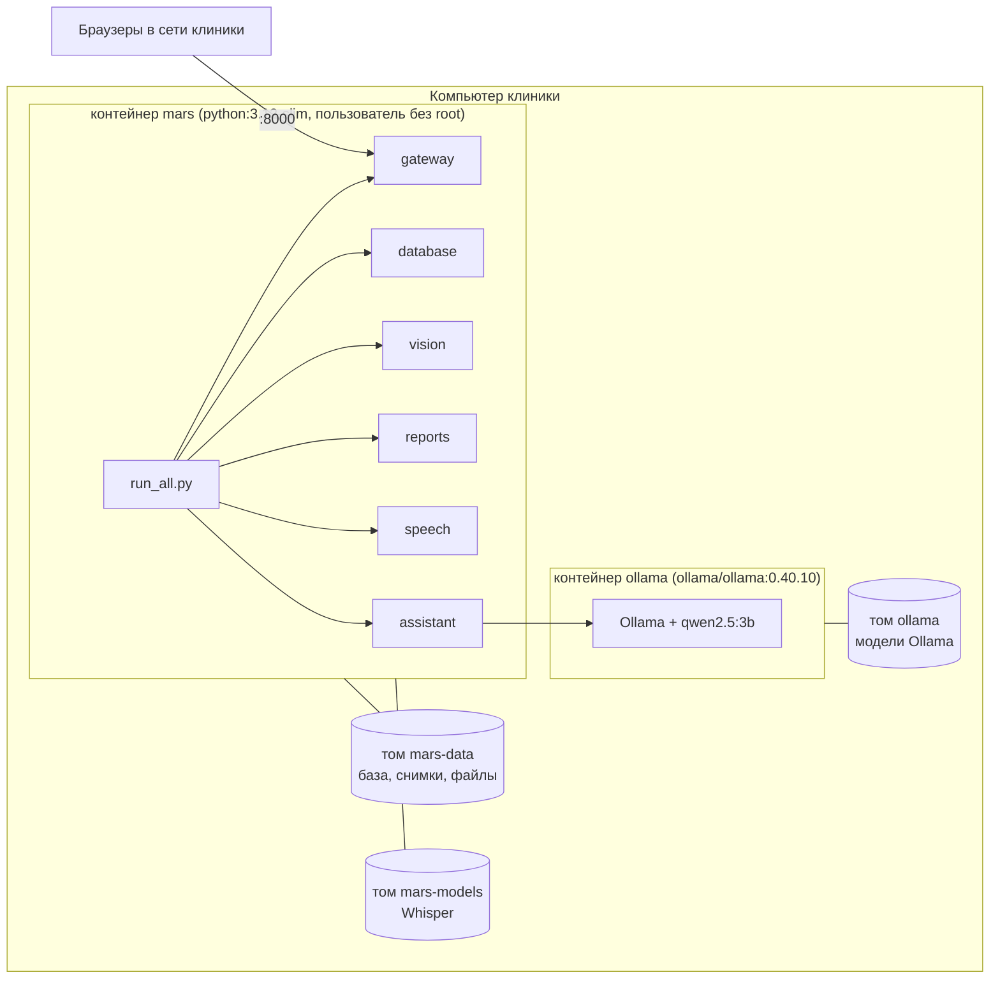

# 1. Архитектура

## 1.1 Компоненты

- **Снаружи доступен только gateway.** Остальные сервисы слушают `127.0.0.1` и принимают лишь запросы с HMAC-подписью.
- **Видео и звук идут между браузерами напрямую.** Сервер передаёт только сигнальные сообщения WebRTC, чтобы браузеры нашли друг друга.

## 1.2 Сервисы

| Сервис | Порт | Ответственность | Состояние | Код |
|---|---|---|---|---|
| **gateway** | 8000 | Интерфейс (одностраничное приложение), вход врача, приёмы, комнаты и сигнализация, файлы и снимки, очередь заданий для остальных сервисов | Комнаты в памяти, данные — в database | `gateway/src/` → `gateway/mars.py` |
| **database** | 8005 | Хранение, именованные SQL-запросы, миграции схемы, резервные копии | SQLite (`mars.sqlite3`) | `database/` |
| **vision** | 8001 | Метрики симметрии, подвижности, сравнения «до и после», калибровки; поиск точек на снимке, если есть MediaPipe для Python | Без состояния | `vision/` |
| **speech** | 8003 | Распознавание речи (faster-whisper `small`, int8, CPU), параллельно для разных пар | Без состояния | `speech/` |
| **assistant** | 8004 | Обезличивание расшифровки: данные карточки, правила, нейросеть (Ollama или GigaChat) | Без состояния | `assistant/` |
| **reports** | 8002 | Печатная форма заключения | Без состояния | `reports/` |

Общий код всех сервисов — `shared/`:
- настройки и адреса сервисов (`config.py`);
- HMAC-подпись запросов (`security.py`);
- клиент вызова с таймаутом и выключателем цепи (`client.py`);
- единый формат ошибок (`errors.py`);
- каркас HTTP-сервиса с `/health` и `/ready` (`service_base.py`);
- выбор режима «потоки или процессы» (`parallel.py`).

## 1.3 Где выполняются вычисления

| Данные | Где обрабатываются | Что попадает на сервер |
|---|---|---|
| Видео с камеры | Браузер пациента | Ничего. Снимки — только подтверждённые пациентом |
| Точки лица, поза, мимика | Браузер пациента (MediaPipe) | Координаты точек и коэффициенты |
| Метрики лица | vision; браузер считает сам, если vision не ответил за 6 с | — |
| Речь | speech на сервере | Куски аудио по 10 с, удаляются сразу после расшифровки |
| Обезличивание | assistant на сервере (локальная Ollama) | — |

## 1.4 Связи между сервисами

- **Протокол:** HTTP/JSON. Запросы gateway → сервис подписываются HMAC-SHA256 общим секретом (заголовки `X-MARS-Sig`, `X-MARS-Ts`, допустимый сдвиг часов 60 с). `SERVICE_SECRET` создаётся при каждом запуске `run_all.py`.
- **Клиент вызова** (`shared/client.py`):
  - таймаут на каждый запрос;
  - **выключатель цепи**: после 3 ошибок подряд сервис считается недоступным, раз в 10 с проходит пробный запрос.
- **Единый формат ошибок:** `{"error", "message", "service"}`. При отказе сервиса gateway отвечает `503` с `Retry-After` и `"degraded": true`.
- **Состояние системы:** `GET /status` в gateway собирает `/ready` всех сервисов. Интерфейс опрашивает его раз в 15 с и показывает индикатор, если что-то недоступно.
- **gateway не содержит SQL.** Все запросы лежат в `database/queries.py` под именами (`appointments.by_id`, `jobs.due`…). gateway вызывает их через `POST /v1/q {name, args}`, произвольный SQL database не принимает.

## 1.5 Клиент

Одностраничное приложение на чистом JavaScript без сборщика и сторонних библиотек.
- Исходники — `gateway/src/*.js`, `b_head.html` (разметка и стили). `gateway/build.sh` вшивает их в `gateway/mars.py`, CI проверяет, что сборка актуальна.
- DOM строится функцией `h()` без `innerHTML`, это защищает от XSS.

| Модуль | Файл | Назначение |
|---|---|---|
| `Api`, `Ui`, `Toast`, `T()` | `c_js1.js`, `c_i18n.js` | Запросы, диалоги, уведомления, перевод на английский |
| `Auth`, `Appointments`, `Rtc`, `Quality`, `Poller`, `Session` | `c_js2.js` | Вход, расписание, WebRTC, качество связи, длинный опрос событий, сессия приёма |
| `CallUi`, `Header`, `App` | `c_js3.js` | Экран звонка, шапка, вкладки, печать |
| `FaceMesh.*` | `d_face1–3.js` | Анализ лица: загрузка модели, наложение, поза, симметрия, подвижность, съёмка, сравнение, калибровка, отчёт, FHIR |
| `Speech` | `e_speech.js` | Запись и отправка кусков речи |
| `Transcript` | `f_transcript.js` | Вкладка «Расшифровка» у врача |

## 1.6 Развёртывание

Без Docker то же самое запускает `python run_all.py`: он поднимает сервисы, `database` первым, и перезапускает упавший через 3–10 с. Подробнее — [Установка и настройка](deployment.md).
