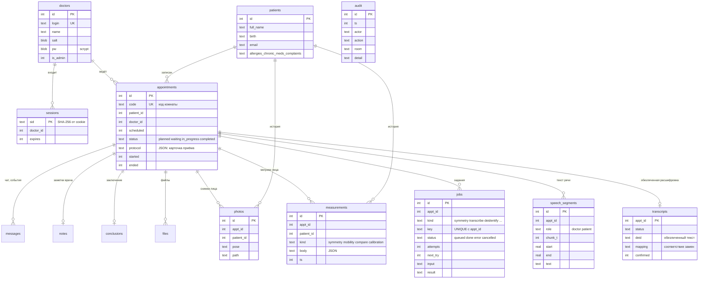
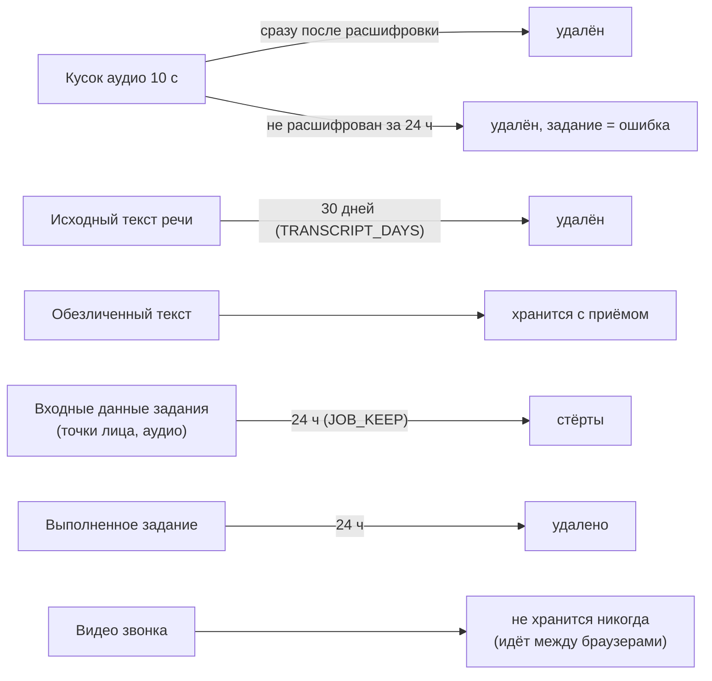

# 5. Данные

## 5.1 Модель данных

База — SQLite в сервисе database (`DATA_DIR/mars.sqlite3`). Схема описана в `database/schema.py`, все запросы — в `database/queries.py`.

Таблицы `messages`, `notes`, `conclusions`, `files` устроены просто: привязка к приёму, время, отправитель, содержимое. Файлы, снимки и аудио хранятся на диске в `DATA_DIR/files`, `photos`, `audio`, а в базе лежит путь.

## 5.2 Миграции

Схема меняется только **новым шагом в конце списка** `MIGRATIONS` в `database/schema.py`. Номер применённого шага хранится в таблице `schema_version`. База, созданная прежней версией, обновляется при первом запуске без потери данных.

| Шаг | Что делает |
|---|---|
| 1 | Создаёт все таблицы и индексы |
| 2 | Привязывает к пациенту снимки и измерения, сделанные до создания карточки (раньше они выпадали из истории пациента) |

## 5.3 Где лежат данные

| Путь | Что | Доступ |
|---|---|---|
| `DATA_DIR/mars.sqlite3` | База | 0600 |
| `DATA_DIR/files/`, `photos/`, `audio/` | Файлы приёма, снимки лица, куски речи до расшифровки | 0600, папка 0700 |
| `DATA_DIR/backups/` | Резервные копии базы, хранятся 14 последних | 0600 |
| `DATA_DIR/vendor/` | Файлы MediaPipe, проверенные по SHA-256 | — |
| `DATA_DIR/models/` (или `MODELS_DIR`) | Модель Whisper | — |
| `DATA_DIR/admin_password.txt` | Пароль администратора; удаляется после первой смены пароля | 0600 |

## 5.4 Сроки хранения

## 5.5 Лимиты на один приём

Лимиты не дают заполнить диск через один приём. Место пациента занимает тот, кто первым вошёл по коду.

| Что | Лимит | Ответ при превышении |
|---|---|---|
| Файлы | 200 МБ (`APPT_FILES_MB`) | 413 |
| Снимки | 300 (`APPT_PHOTOS`) | 413 |
| Измерения | 500 (`APPT_MEASUREMENTS`) | 413 |
| Куски речи в очереди | 720, это 2 часа (`APPT_QUEUED_AUDIO`) | 413 |
| Свободное место на диске | не меньше 500 МБ (`MIN_FREE_MB`) | 507 |
| JSON / файл / снимок | 25 / 20 / 5 МБ | 413 |
