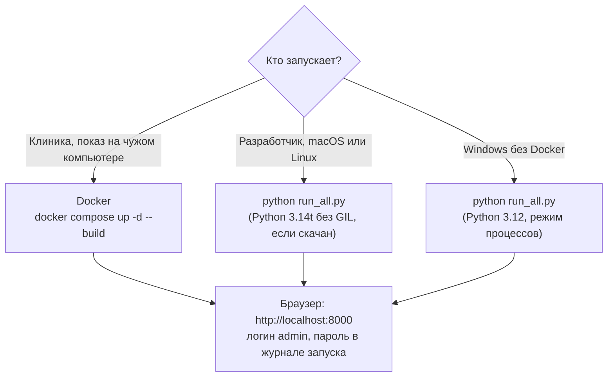

# 11. Установка и настройка

## 11.1 Варианты запуска



| | Docker | run_all.py |
|---|---|---|
| Что нужно | Docker Desktop | Python 3.12+ (или 3.14t), Ollama |
| Установка зависимостей | Внутри образа | `speech/requirements.txt` в `speech/.venv` |
| Ollama | Отдельный контейнер | Ставится отдельно |
| Данные | Тома `mars-data`, `mars-models`, `ollama` | `mars_data/` |
| Проверено | CI на Linux | macOS (Intel); Windows не проверялся |

## 11.2 Docker

```bash
git clone https://github.com/FaU-0/M.A.R.S.git
cd M.A.R.S
docker compose up -d --build
docker compose exec ollama ollama pull qwen2.5:3b
docker compose logs mars | grep "Вход администратора"
```

- `docker build --build-arg WITH_MEDIAPIPE=1` добавляет MediaPipe для Python: тогда vision ищет точки на снимке и на сервере.
- Контейнер работает от пользователя без прав root, проверка живости — `/health`.
- В Windows вместо `grep`: `docker compose logs mars | Select-String "Вход администратора"`.

## 11.3 Без Docker (macOS, Linux)

```bash
python3 -m venv speech/.venv
speech/.venv/bin/pip install -r speech/requirements.txt
ollama pull qwen2.5:3b
python3 run_all.py
```

- **Python 3.14t без GIL.** Если в проекте есть `.python314t/`, `run_all.py` запускает на нём все сервисы, а расшифровку — потоками (`speech/.venv314t`, `PYTHON_GIL=0`).
- **MediaPipe для Python на Mac с Intel** ставится только с `SYSTEM_VERSION_COMPAT=0`: Python из Anaconda видит macOS как 10.16.
  ```bash
  python3 -m venv vision/.venv
  SYSTEM_VERSION_COMPAT=0 vision/.venv/bin/pip install --only-binary=:all: mediapipe==0.10.21 sentencepiece==0.2.1
  ```
  Если окружение `vision/.venv` есть, `run_all.py` запускает vision в нём.

## 11.4 Windows без Docker

```powershell
git clone https://github.com/FaU-0/M.A.R.S.git
cd M.A.R.S
pip install -r speech/requirements.txt
ollama pull qwen2.5:3b
$env:PYTHONUTF8 = "1"
python run_all.py
```

На Windows нет Python 3.14t, поэтому расшифровка идёт в режиме процессов. Отдельное окружение для speech не обязательно: если `speech/.venv` нет, используется установленный Python.

## 11.5 Подключение пациента с другого устройства

Браузер включает камеру только на `https://` или `http://localhost`.

| Способ | Как |
|---|---|
| Туннель | `cloudflared tunnel --protocol http2 --url http://localhost:8000` выдаёт адрес `https://…trycloudflare.com`; пациент открывает его с `?code=КОД` |
| Свой сертификат | `CERT_FILE=cert.pem KEY_FILE=key.pem python run_all.py`; сертификат должен содержать IP сервера в `subjectAltName` |
| Разные сети, мобильный интернет | TURN-сервер: `TURN_URL`, `TURN_SECRET` |

## 11.6 Основные переменные окружения

| Переменная | По умолчанию | Назначение |
|---|---|---|
| `PORT` | `8000` | Порт gateway |
| `DATA_DIR` | `mars_data` | База, файлы, снимки, резервные копии |
| `ADMIN_PASSWORD` / `RESET_ADMIN` | случайный / `False` | Пароль администратора; сброс забытого пароля |
| `CERT_FILE`, `KEY_FILE` | — | HTTPS |
| `TURN_URL`, `TURN_SECRET` | — | TURN-сервер |
| `SMTP_*` | — | Приглашения по email |
| `CENTER_NAME` | `Медицинский центр` | Название в интерфейсе и документах |
| `WHISPER_MODEL`, `WHISPER_THREADS`, `SPEECH_WORKERS` | `small`, число ядер, `2` | Расшифровка речи |
| `MODELS_DIR` | `DATA_DIR/models` | Где хранятся модели Whisper |
| `OLLAMA_URL`, `OLLAMA_MODEL` | `127.0.0.1:11434`, `qwen2.5:3b` | Локальная нейросеть |
| `LLM_BACKEND` | `ollama` | `gigachat` — облако, только для экспериментов |
| `GIGACHAT_AUTH_KEY`, `GIGACHAT_MODEL`, `GIGACHAT_CA_FILE` | —, `GigaChat-2-Max`, — | Облачный режим |
| `TRANSCRIPT_DAYS` | `30` | Хранение исходной расшифровки |
| `BACKUP_HOURS`, `BACKUP_KEEP` | `24`, `14` | Резервные копии |
| `APPT_FILES_MB`, `APPT_PHOTOS`, `APPT_MEASUREMENTS`, `APPT_QUEUED_AUDIO`, `MIN_FREE_MB` | 200, 300, 500, 720, 500 | Лимиты на приём и диск |

Полный список — в [README](../README.md#настройки).

## 11.7 Требования к железу

| | Минимум (замерено) | Комментарий |
|---|---|---|
| Процессор | 4 ядра | Расшифровка вовремя для 1–2 пар одновременно; видеоприём без расшифровки — 16 пар |
| Память | 8 ГБ | На пределе под нагрузкой: Ollama около 2,1 ГБ, Whisper около 0,6–0,9 ГБ |
| Диск | около 5 ГБ | Whisper около 0,5 ГБ, модель Ollama около 2 ГБ, база выросла на 41 МБ за 31 приём нагрузочного теста (около 1,3 МБ на приём) |
| Видеокарта | не нужна | С видеокартой Whisper и Ollama были бы в разы быстрее (не проверено) |
