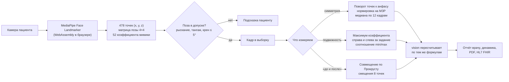

# 3. Анализ лица

## 3.1 Конвейер

Файлы модели MediaPipe (версия 0.10.14, 22 МБ):
- gateway скачивает их один раз и проверяет по SHA-256;
- браузер получает их с сервера клиники, а не из интернета.

Модель `face_landmarker.task` у браузера и у `vision/detector.py` одна и та же.

## 3.2 Контроль позы

Углы рыскания (yaw), тангажа (pitch) и крена (roll) берутся из матрицы преобразования MediaPipe. Знак рыскания уточняется по положению носа относительно уголков глаз.

| Режим | Допуск |
|---|---|
| Симметрия, стандартная съёмка | 5° (настраивается врачом) |
| Подвижность | вдвое шире, но не меньше 10° |

Кадр вне допуска в расчёт не попадает, пациент видит подсказку: расстояние, свет, наклон, неподвижность. На цифровом фантоме наклон головы 6° отклоняется в 100 % случаев ([метрология](metrology.md)).

## 3.3 Симметрия

1. **Поворот к анфасу.** Точки поворачиваются обратной матрицей позы и центрируются (`derot` в `vision/metrics.py`).
2. **Система координат лица:**
   - начало — середина между центрами зрачков (точки 468 и 473);
   - ось x идёт вдоль линии зрачков, ось y — перпендикулярно ей;
   - единица — **межзрачковое расстояние (МЗР)**. Так значения сравнимы между приёмами, даже если пациент сидел ближе или дальше от камеры.
3. **Метрики одного кадра:**

| Метрика | Точки MediaPipe (правая / левая) | Как считается |
|---|---|---|
| Внешние уголки глаз | 33 / 263 | расстояние до средней линии |
| Внутренние уголки глаз | 133 / 362 | расстояние до средней линии |
| Уголки рта | 61 / 291 | расстояние до средней линии |
| Высота бровей | 105 / 334 | высота над линией зрачков |
| Высота уголков рта | 61 / 291 | положение относительно линии зрачков |
| Ширина половин лица | 234 / 454 | расстояние до средней линии |
| Наклон линии глаз | 468–473 | угол, градусы |
| Смещение кончика носа, подбородка | 1, 152 | от средней линии |

4. **Одно измерение** — медиана по 12 кадрам в допуске позы. В отчёте показываются правая и левая сторона и их разность.
5. **Погрешность.** Если разность меньше погрешности системы, она помечается «в пределах погрешности» (†). Порог ≈ 2 SD смещения нуля на цифровом фантоме: брови 0,9 мм, высота уголков рта 0,7 мм, наклон 0,5° и т. д.

## 3.4 Калибровка в миллиметрах

| Способ | Как | Точность |
|---|---|---|
| Банковская карта | Карта стандартного размера (85,6 × 53,98 мм) рядом с лицом, масштаб по её 4 углам в кадре | Основной способ |
| Радужка | Диаметр радужки принят за 11,7 мм | Приблизительно |

Без калибровки миллиметры не показываются и сервером не принимаются. Масштаб задаётся через МЗР в мм (`calibration.ipd_mm`).

## 3.5 Подвижность

| Задание | Команда пациенту | Коэффициенты MediaPipe |
|---|---|---|
| Улыбка | «Широко улыбнитесь и держите улыбку» | `mouthSmileRight/Left` |
| Подъём бровей | «Поднимите брови как можно выше» | `browOuterUpRight/Left` |
| Закрытие глаз | «Мягко закройте глаза, не зажмуриваясь» | `eyeBlinkRight/Left` |
| Надувание щёк | «Надуйте щёки и держите» | `cheekPuff` (общий) |
| Открытие рта | «Широко откройте рот» | `jawOpen` (общий) |
| Поджатие губ | «Плотно сожмите губы» | `mouthPressRight/Left` |

- Для каждой стороны берётся максимум коэффициента за задание (не меньше 10 кадров в допуске).
- **Соотношение сторон** = min / max: 1 — стороны одинаковы.
- **Индекс асимметрии подвижности** = среднее (1 − соотношение) по бровям, улыбке и закрытию глаз. На наборе MEEI у здоровых он не выше 0,27, этот ориентир показывается в отчёте.

Задание на глаза изменено по результатам клинической проверки: сильное зажмуривание асимметрию не показывает (AUC 0,51), мягкое закрытие — показывает (AUC 0,64). Подробно — в разделе [метрологии](metrology.md).

## 3.6 Стандартная съёмка и сравнение «до и после»

- **Ракурсы:** анфас, 45° влево и вправо, профиль. Снимок делается только при позе в допуске, после отсчёта 3-2-1, и сохраняется после подтверждения пациентом. Лицо можно скрыть пикселизацией.
- **Сравнение:** снимки «до» и «после» совмещаются по жёстким точкам (уголки глаз, переносица, нос, лоб) методом Прокруста. Затем считаются смещения 8 ключевых точек. Режимы просмотра: шторка, наложение, стрелки.

## 3.7 Повторяемость в приложении

Режим «Проверка повторяемости» делает серию из 3, 5 или 10 замеров подряд. Для каждой метрики считаются среднее, SD и **MDC95 = 1,96 · √2 · SD** — минимальное изменение, которое можно отличить от шума. Таблица выгружается в CSV.

## 3.8 Экспорт HL7 FHIR R4

Отчёт по лицу выгружается как Bundle типа `collection`:
- ресурс `Patient` с идентификатором клиники;
- по одному ресурсу `Observation` на каждую метрику: правая сторона, левая сторона и разность — компоненты;
- единицы UCUM: `mm`, `1` (доли МЗР), `deg`;
- коды из системы `urn:mars:face-metric`: кодов LOINC для этих метрик нет.

Проверка: `tests/test_fhir.py`.
