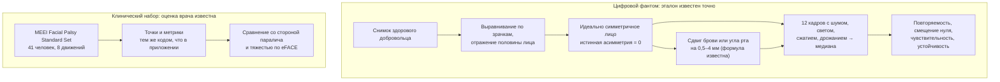
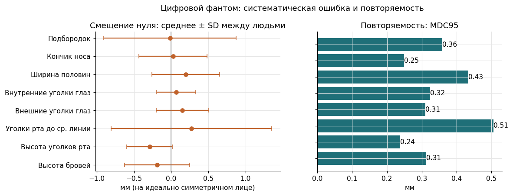
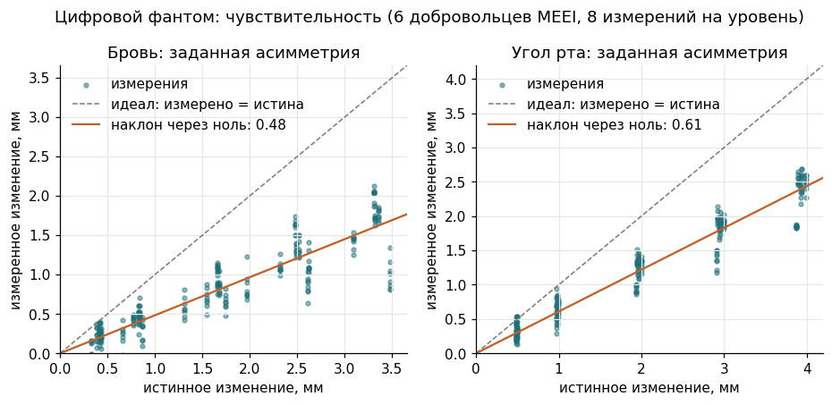
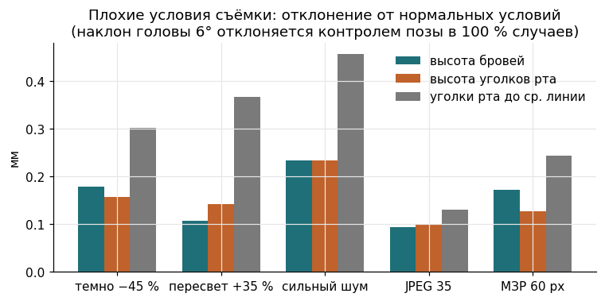
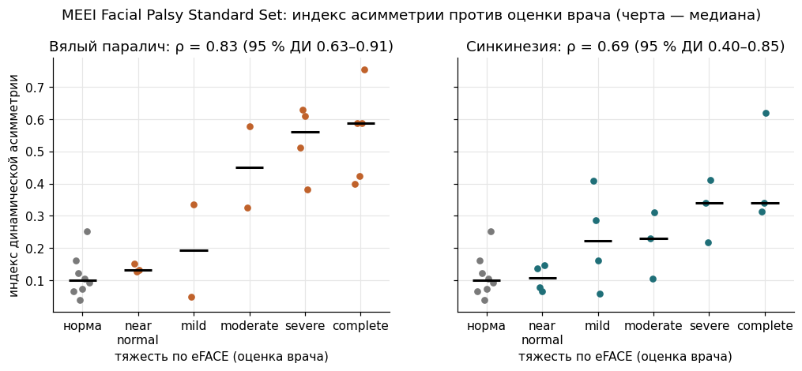
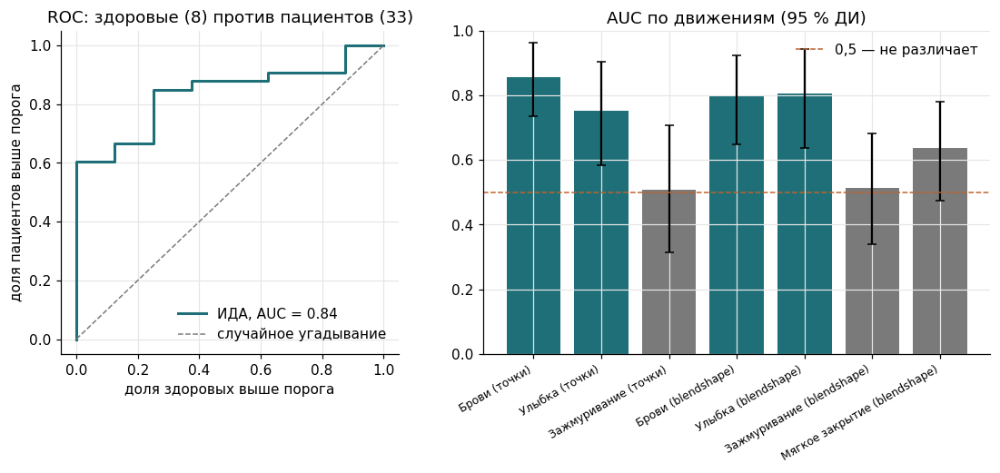

# 9. Метрология и клиническая проверка

**Вопрос:** можно ли доверять числам M.A.R.S.? Проверка проведена **без живых испытуемых** двумя независимыми способами. Код — `metrology/`, полный отчёт — [`metrology/REPORT.md`](../metrology/REPORT.md).

Точки находит MediaPipe с той же моделью, что в браузере. Метрики считает `vision/metrics.py` — те же формулы. Снимки уменьшены до 1920 пикселей, как кадр камеры Full HD. Миллиметры получены из долей МЗР при МЗР = 63 мм.

## 9.1 Повторяемость и систематическая ошибка

- **Повторяемость высокая:** MDC95 = 0,1–0,5 мм. Изменение больше 0,5 мм между двумя измерениями при одинаковой съёмке — не шум.
- **Смещение нуля до ±1 мм между людьми.** На идеально зеркальном лице MediaPipe ставит парные точки несимметрично на 1–4 пикселя, около 1 % МЗР. Поэтому асимметрию в покое меньше ~1 мм нельзя отличить от ошибки модели. В отчёте она помечается «в пределах погрешности».

## 9.2 Чувствительность: измерено против истины

| Область | Доля увиденного | Наклон регрессии (R²) |
|---|---|---|
| Бровь | 47–51 % | 0,47 (0,82) |
| Угол рта | 60–67 % | 0,59 (0,94) |

Зависимость линейная, но масштаб занижен: MediaPipe подгоняет точки под типичную форму лица и частично сглаживает местные изменения. **Динамика верна по направлению и пропорциям, абсолютные миллиметры занижены.**

## 9.3 Плохие условия съёмки

Темнота, пересвет, сильный шум, сжатие JPEG 35, МЗР 60 пикселей меняют результат не больше чем на 0,1–0,5 мм. Наклон головы 6° контроль позы отбрасывает в 100 % случаев, как и задумано.

## 9.4 Сравнение с оценками врачей (MEEI)

**Набор:** MEEI Facial Palsy Photo and Video Standard Set (Greene et al., *Laryngoscope* 2020).
- 10 здоровых и 41 пациент с описанной в таблице стороной и тяжестью;
- 8 снимков движений;
- категория тяжести по шкале **eFACE**, которую выставил врач.

Набор открыт для исследований и обучения. Снимки в репозиторий не входят. В анализ вошёл 41 человек: у 10 поза на каком-то снимке вышла за допуск 10°.

**Индекс динамической асимметрии (ИДА)** — среднее (1 − min/max) амплитуды движения сторон для бровей, глаз и улыбки. План анализа зафиксирован в коде до первого запуска.

| Показатель | Значение (95 % ДИ) |
|---|---|
| Сторона паралича определена верно | **82 %** (66–91 %), 27 из 33 |
| AUC «здоровые против пациентов» | **0,84** (0,70–0,95) |
| ρ Спирмена с тяжестью: вялый паралич | **0,83** (0,63–0,91) |
| ρ Спирмена с тяжестью: синкинезия | **0,69** (0,40–0,85) |

- Лучше всего работают **брови и улыбка**: AUC 0,75–0,86 и по точкам, и по коэффициентам мимики приложения.
- **Сильное зажмуривание не различает** пациентов и здоровых (AUC 0,51): зажмуриться может и поражённая сторона. **Мягкое закрытие** различает лучше (0,64).
- Правая и левая сторона в коэффициентах мимики определяются верно: подъём бровей указывает на сторону паралича в 83 % случаев.

## 9.5 Что изменено в приложении по результатам

| Результат проверки | Изменение |
|---|---|
| Смещение нуля до ±1 мм | Разность сторон меньше погрешности помечается «в пределах погрешности» (†) |
| Брови, улыбка и мягкое закрытие глаз различают пациентов | Индекс асимметрии подвижности в отчёте, ориентир по здоровым ≤ 0,27 (AUC 0,87 — разведочный результат) |
| Зажмуривание не работает | Задание «Мягко закройте глаза, не зажмуриваясь» |
| Опорная линия по уголкам глаз вместо зрачков | Проверена на фантоме: выигрыша нет, формула не изменена |

## 9.6 Ограничения

- Фантом — программная деформация снимка, а не сокращение мышц.
- Миллиметры пересчитаны из МЗР 63 мм, без калибровки.
- В открытой таблице MEEI нет баллов House–Brackmann и Sunnybrook по каждому пациенту, поэтому сравнение идёт с категорией eFACE.
- Выборка маленькая, из одного центра, снимки сделаны фотоаппаратом.
- Повторных съёмок живых людей и сравнения с линейкой не было.
