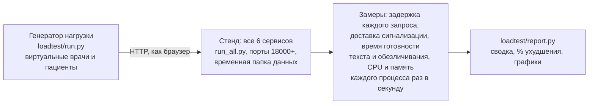
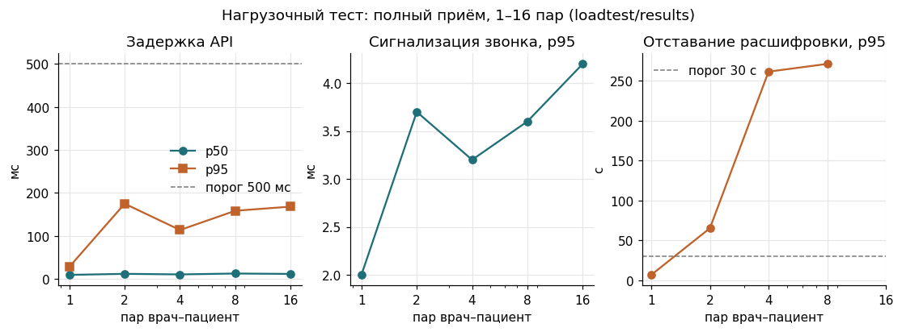
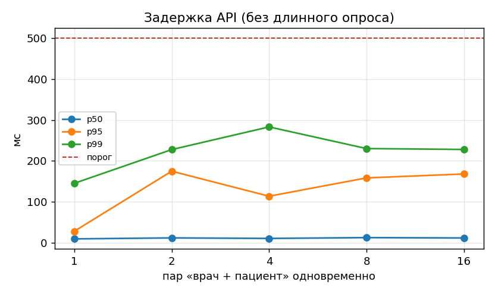
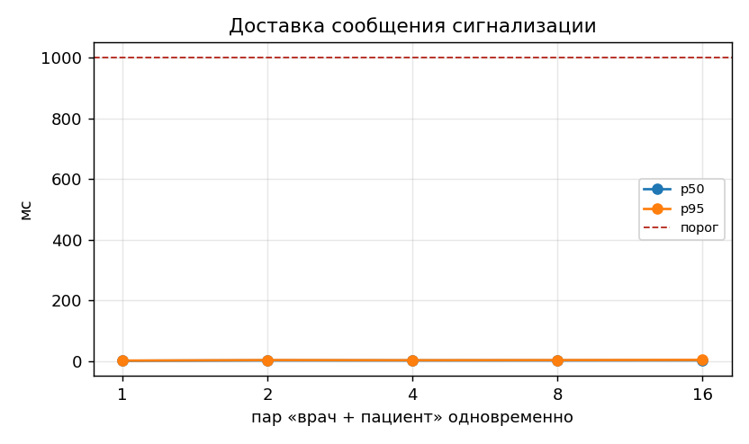
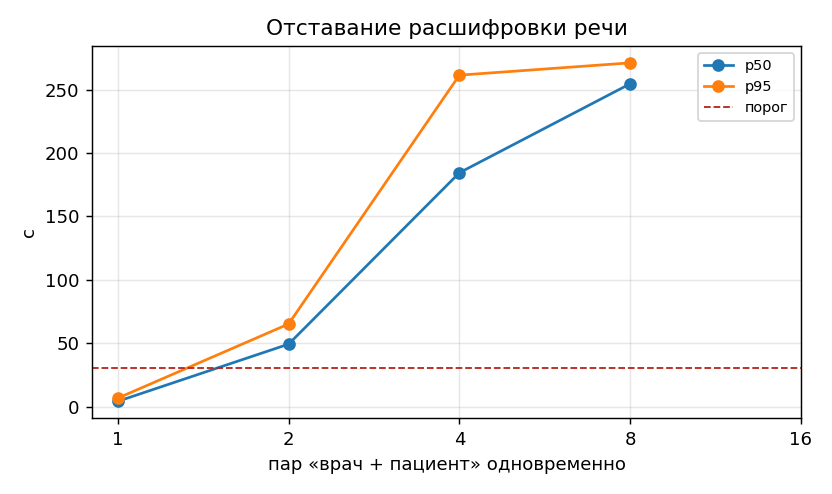
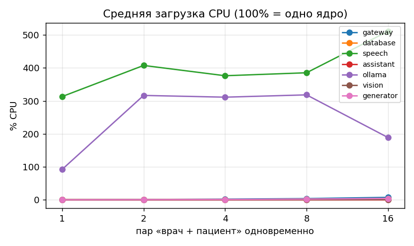
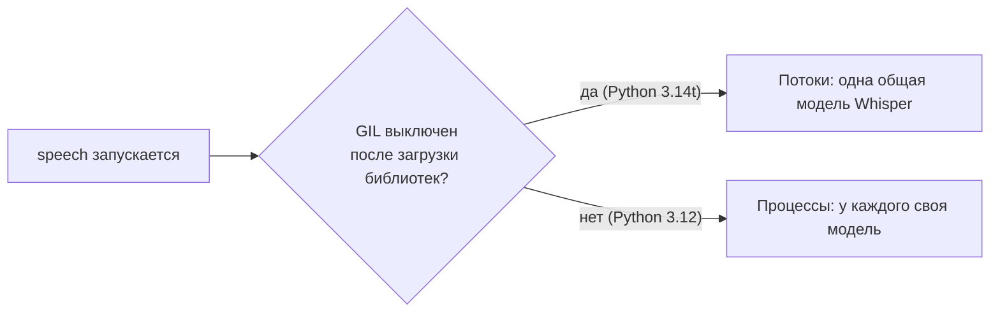
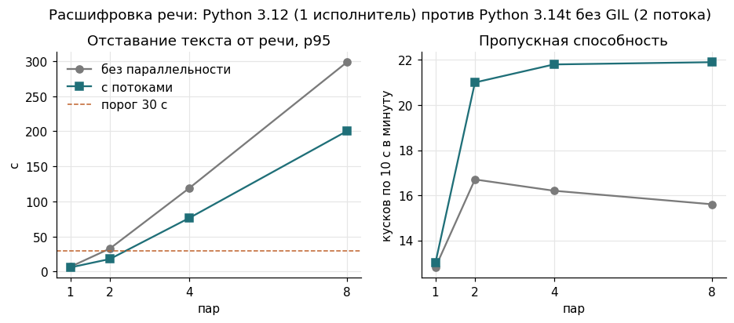
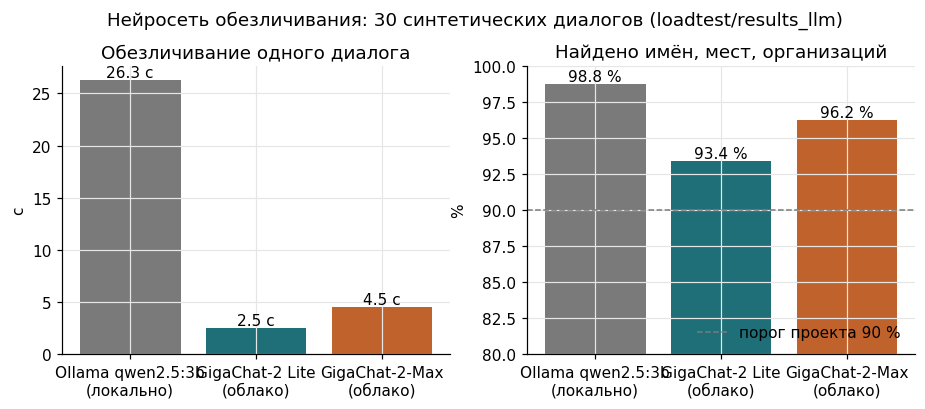
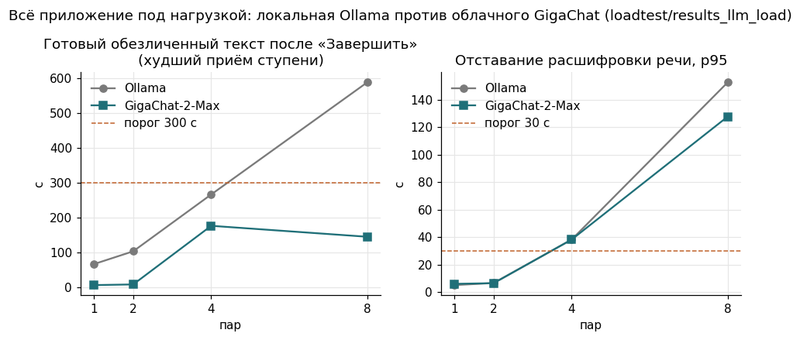

# 8. Производительность

Все замеры сделаны на одном ноутбуке: **MacBook Pro 13", Intel Core i5 1,4 ГГц, 4 ядра (8 потоков), 8 ГБ RAM, без видеокарты**. Сырые данные лежат в `loadtest/results*/`, скрипты — в `loadtest/`. Графики этого раздела пересобирает `python3 docs/make_charts.py`.

## 8.1 Методика

**Сценарий одной пары** повторяет настоящий приём:
- вход врача, создание приёма;
- вход пациента, согласия, сигнализация WebRTC;
- карточка, заметки, чат;
- речь обеих сторон кусками по 10 с из записанных русских диалогов;
- один расчёт лица;
- «Завершить приём», обезличивание, печать заключения.

**Ступени нагрузки:** 1, 2, 4, 8, 16 пар одновременно. Видео и звук не моделируются: они идут между браузерами и сервер не нагружают.

**Пороги «работает нормально»:**

| Метрика | Порог |
|---|---|
| p95 задержки API (кроме длинного опроса) | < 500 мс |
| p95 доставки сигнализации | < 1 с |
| Ошибки | < 1 % |
| Отставание расшифровки p95 (от отправки куска до готового текста) | < 30 с |
| Обезличивание после «Завершить приём» | < 5 мин |
| Печать заключения p95 | < 2 с |

## 8.2 Основной нагрузочный тест (1–16 пар)

| Пар | API p50 / p95, мс | Сигнализация p95, мс | Ошибки | Отставание расшифровки p95, с | CPU системы |
|---|---|---|---|---|---|
| 1 | 9,1 / 27,8 | 2,0 | 0 % | 6,6 | 60 % |
| 2 | 11,5 / 174,7 | 3,7 | 0 % | **65,1** ✗ | 97 % |
| 4 | 10,2 / 113,5 | 3,2 | 0 % | 261,4 ✗ | 98 % |
| 8 | 12,2 / 158,3 | 3,6 | 0 % | 271,1 ✗ | 98 % |
| 16 | 11,3 / 167,9 | 4,2 | 0 % | не успело ✗ | 98 % |

**Выводы:**
- **Видеоприём без расшифровки держит 16 пар без ошибок:** звонок, чат, карточка, заключение, печать, анализ лица. API p95 ≤ 175 мс, сигнализация ≤ 4,2 мс, расчёт лица 1,4–1,6 с на любой ступени.
- **Узкое место — расшифровка речи на процессоре.** Каждая пара даёт 12 кусков в минуту, а Whisper под нагрузкой успевает около 13. Порог ломается уже на 2 парах.
- **Второе узкое место — обезличивание:** Ollama и Whisper делят те же ядра.
- **Память на пределе:** минимум свободной — 844 МБ. Ollama занимает около 2,1 ГБ, speech — около 0,6 ГБ.
- Не узкие места:
  - gateway: 7,5 % ядра на 16 парах;
  - database: 3,6 % ядра, ни одной ошибки;
  - vision и reports.

Графики стенда:

| Задержка API | Сигнализация |
|---|---|
|  |  |
| **Отставание расшифровки** | **Загрузка процессора по сервисам** |
|  |  |

Полный отчёт с процентами ухудшения, стоимостью и точкой безубыточности: [`loadtest/REPORT.md`](../loadtest/REPORT.md).

## 8.3 Параллельная расшифровка: процессы и потоки (Python 3.14 без GIL)

Куски разных пар расшифровываются одновременно, куски одной пары — по порядку. Режим выбирается автоматически (`shared/parallel.py`):

**Только сервис расшифровки,** 1–8 пар, пары говорят 60 с (`loadtest/bench_transcribe_load.py`):

| Пар | Отставание p95: без параллельности | Отставание p95: потоки | Кусков в минуту: без → с потоками |
|---|---|---|---|
| 1 | 6,8 с | 5,9 с | 12,8 → 13,0 |
| 2 | **32,8 с ✗** | **17,9 с ✓** | 16,7 → 21,0 |
| 4 | 118,6 с | 76,1 с | 16,2 → 21,8 |
| 8 | 298,6 с | 200,3 с | 15,6 → 21,9 |

- На одних и тех же 25 кусках, 3 повтора: потоки **в 1,4 раза быстрее** (69 с против 97 с). Доля ошибочных слов (WER) одинакова — 20,7 %, текст под нагрузкой совпадает с текстом без неё на 100 %.
- **Вовремя расшифровываются 2 пары вместо 1.** Дальше рост упирается в 4 ядра процессора.
- **Во всём приложении** (вместе с Ollama) выигрыш меньше, +14–15 %: процессор и так занят на 97–99 %. При той же скорости потоки тратят на 31 % меньше памяти, чем процессы: 0,90 ГБ против 1,30 ГБ.

Подробно: [`loadtest/MINI_REPORT.md`](../loadtest/MINI_REPORT.md), раздел 6.4–6.6 в [`loadtest/REPORT.md`](../loadtest/REPORT.md).

## 8.4 Нейросеть обезличивания: Ollama против GigaChat

### Только обезличивание
30 синтетических диалогов, по одному прогону, скрипт `loadtest/bench_llm.py`.

| | Ответ на фрагмент p50 / p95 | Один диалог | Найдено имён и мест | Мед. слова | Сбои |
|---|---|---|---|---|---|
| Ollama `qwen2.5:3b` (локально) | 10,8 / 28,0 с | 26,3 с | 98,8 % | 100 % | 0 из 60 |
| GigaChat-2-Max (облако) | 1,9 / 4,5 с | **4,5 с** | 96,2 % | 100 % | 0 из 60 |
| GigaChat-2 Lite (облако) | 1,2 / 2,3 с | **2,5 с** | 93,4 % | 100 % | 0 из 60 |

### Всё приложение под нагрузкой
1–8 пар, приём 60 с, очередь дорабатывается до конца; облако — GigaChat-2-Max.

| Пар | Готовый текст после «Завершить», худший приём: Ollama / GigaChat | Вся работа ступени разобрана за: Ollama / GigaChat | Отставание расшифровки p95: Ollama / GigaChat |
|---|---|---|---|
| 1 | 66 / **6 с** | 66 / **6 с** | 5,1 / 6,0 с |
| 2 | 103 / **7 с** | 104 / **8 с** | 6,6 / 6,5 с |
| 4 | 266 / **176 с** | 267 / **179 с** | 38,2 / 38,2 с |
| 8 | **588 ✗** / 144 с | 590 / **146 с** | 152,5 / 127,6 с |

**Выводы:**
- Облако обезличивает в 6 раз быстрее, а готовый текст после приёма появляется в **4–13 раз** быстрее.
- На 4–8 парах выигрыш меньше, потому что обезличивание ждёт, пока Whisper доделает текст.
- Облако освобождает процессор для Whisper: на 8 парах отставание расшифровки меньше на 16 %.
- **Но в облако уходит текст с ещё не скрытыми именами (152-ФЗ).** Поэтому по умолчанию работает локальная Ollama, а облако — только эксперимент на синтетических данных.

Подробно: [`loadtest/LLM_REPORT.md`](../loadtest/LLM_REPORT.md).

## 8.5 Ограничения замеров

- Каждая ступень прогонялась один раз; генератор нагрузки работал на том же ноутбуке (до 4 % CPU).
- Ступени основного теста шли подряд, поэтому отставание на 4–16 парах завышено очередью предыдущих ступеней. Вывод о максимальном числе пар от этого не зависит.
- Лимит входа — 8 раз с одного IP, поэтому в тесте 8 учётных записей врачей.
- Отдельного стресс-теста с сотнями длинных опросов и предельного теста SQLite не было.
