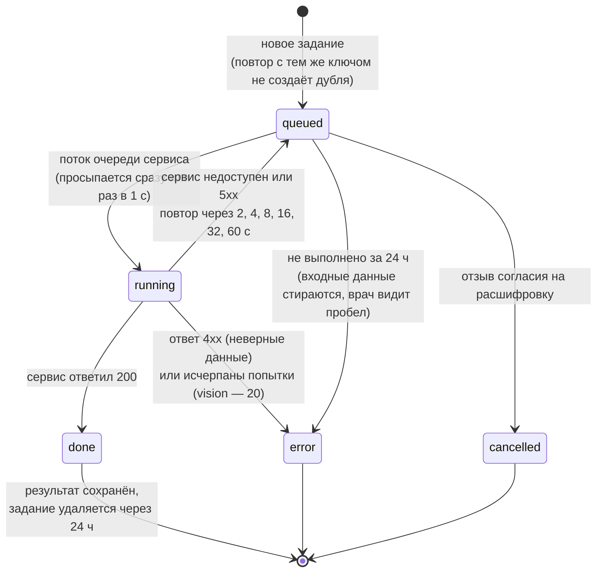
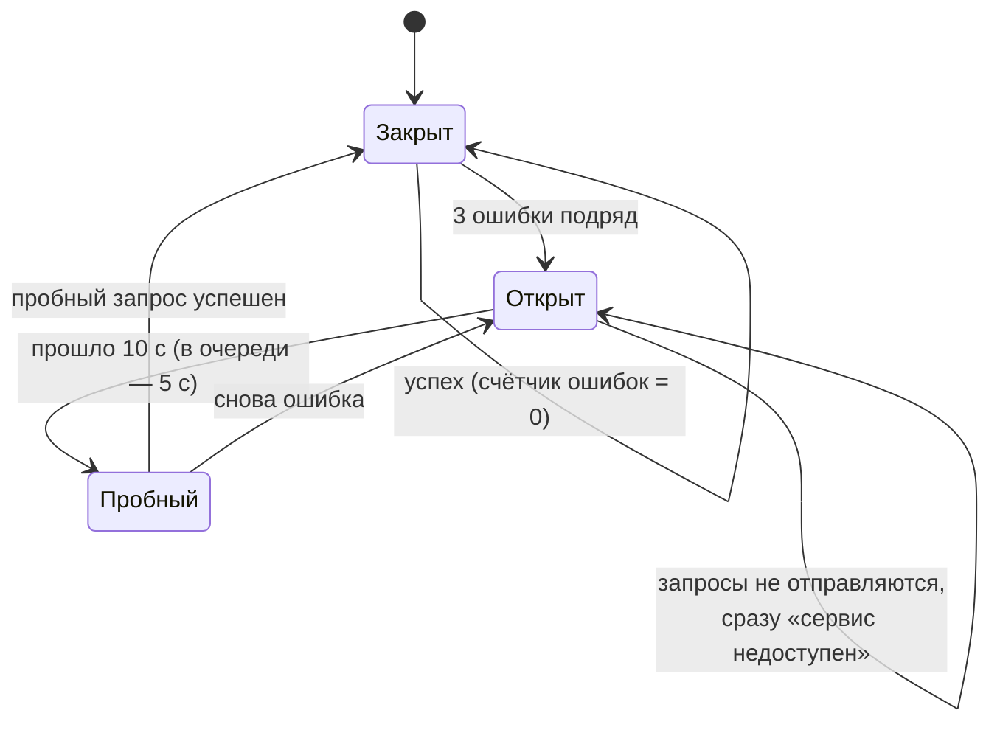
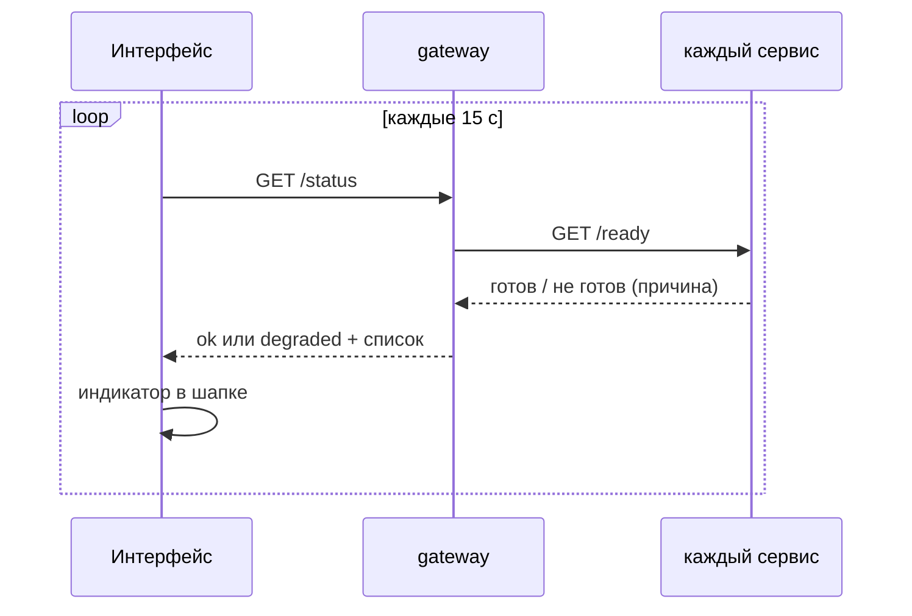

# 6. Надёжность

**Принцип:** тяжёлые и потенциально ненадёжные части системы — нейросети, печать, расчёты — вынесены в отдельные сервисы и работают через очередь заданий. Сбой любого из них не прерывает приём.

## 6.1 Очередь заданий

gateway не ждёт ответа тяжёлого сервиса в запросе пользователя. Он записывает **задание** в таблицу `jobs` (сервис database) и сразу отвечает `202` с номером задания.

| Сервис | Виды заданий | Таймаут | Попытки | Параллельно |
|---|---|---|---|---|
| vision | symmetry, mobility, compare, calibrate | 10 с | 20 | 1 |
| speech | transcribe | 120 с | без ограничения (до 24 ч) | `SPEECH_WORKERS` = 2: разные пары одновременно, одна пара по порядку |
| assistant | deidentify | 30 мин | без ограничения (до 24 ч) | 1 (ждёт, пока расшифруются все куски приёма) |

- В базе хранятся статусы `queued`, `done`, `error`, `cancelled`. Состояние «выполняется» (running) существует только в памяти потока очереди.
- Сетевой сбой, таймаут, ответ 5xx или открытый выключатель цепи дают повтор позже. Ответ 4xx означает ошибку в данных: задание завершается с ошибкой, без повторов.
- У каждого сервиса **свой поток очереди**, поэтому зависший Whisper не задерживает расчёт лица.
- Задания **переживают перезапуск** gateway: очередь хранится в базе.

## 6.2 Выключатель цепи

Клиент вызова — `shared/client.py`. Благодаря выключателю gateway не тратит время на таймауты к упавшему сервису и отвечает пользователю сразу: `503` с `Retry-After` и `"degraded": true`.

## 6.3 Что работает при отказе каждого сервиса

| Упал | Продолжает работать | Что видит пользователь |
|---|---|---|
| reports | Всё остальное | Печать заключения идёт из браузера |
| vision | Звонок, чат, живая сетка в браузере; расчёт ставится в очередь | Метрики считает браузер, сообщение «Анализ временно недоступен» |
| speech | Звонок, заметки, анализ лица; куски речи ждут на диске | Индикатор: куски сохранены, расшифровка догрузится сама |
| assistant | Всё, включая расшифровку; исходный текст сохранён | Обезличивание ждёт; в отчёт текст не попадёт, пока не обезличен и не проверен |
| database | Идущий звонок: сигнализация WebRTC в базу не ходит, сессия врача действует до 10 мин по последней проверке | Остальные действия отвечают 503 «База данных временно недоступна» за несколько секунд, без зависания |
| gateway | — | Недоступно всё. `run_all.py` поднимает его заново через 3–10 с |

Сценарии проверены автотестами:
- `tests/test_resilience.py` — `/status` при остановке каждого сервиса;
- `tests/test_failover.py` — полный набор, каждый сервис по очереди, включая database и gateway.

## 6.4 Мониторинг состояния

`/ready` у каждого сервиса проверяет его зависимости:
- speech — модель Whisper загружена;
- assistant — Ollama отвечает и модель скачана, или получен токен GigaChat;
- database — база открыта.

## 6.5 Резервные копии и перезапуск

- **database** делает копию базы при запуске, если последней больше 24 ч, и затем каждые 24 ч. Копия также делается по запросу `POST /v1/backup`. Хранятся 14 последних (`BACKUP_HOURS`, `BACKUP_KEEP`).
- **run_all.py** следит за процессами. Упавший сервис перезапускается через 3 с, а если он упал сразу после старта — через 10 с. Сигнал SIGTERM корректно останавливает все дочерние сервисы.
