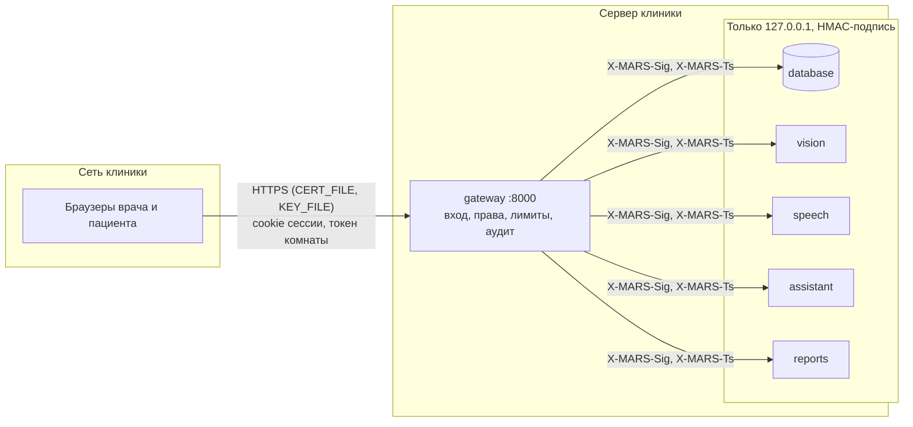
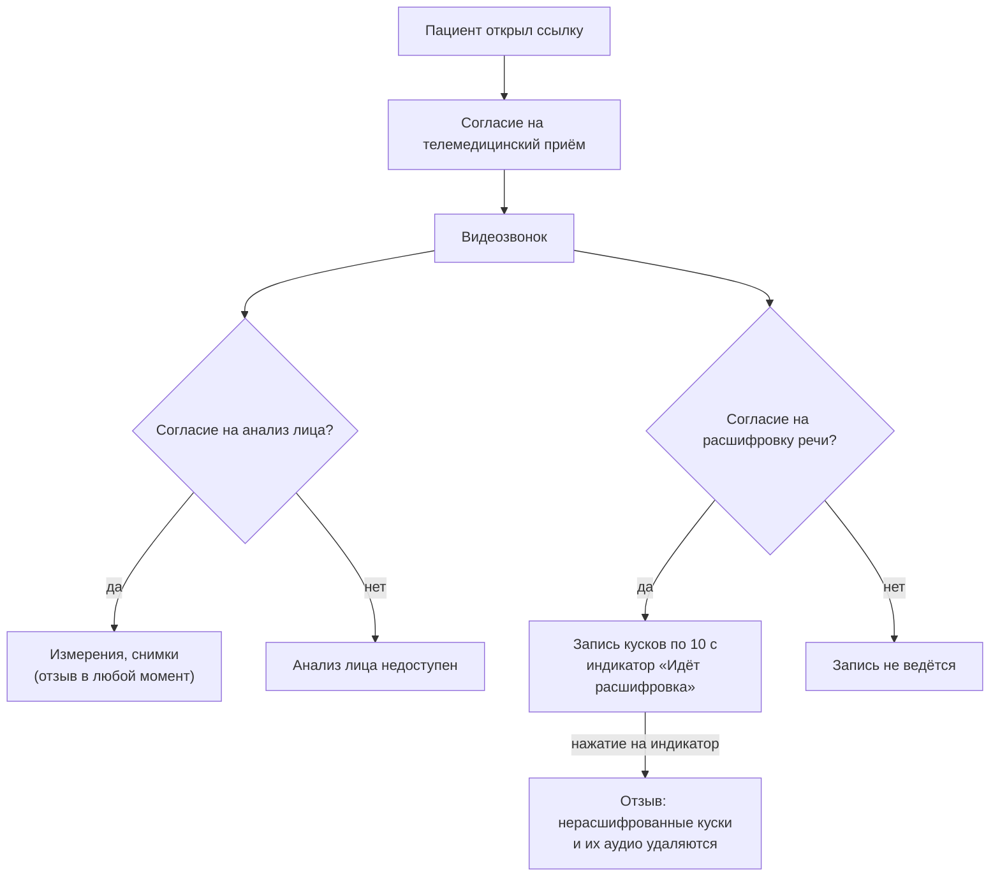

# 7. Безопасность и защита данных

## 7.1 Границы доверия

| Граница | Защита |
|---|---|
| Браузер → gateway | Вход врача: scrypt-хэш пароля, сессия в cookie `HttpOnly; SameSite=Strict` (`Secure` при https). У пациента — токен комнаты. Ограничение частоты по IP и по комнате (token bucket) |
| gateway → сервисы | Сервисы слушают только `127.0.0.1`. Каждый запрос подписан HMAC-SHA256 общим секретом, допустимый сдвиг часов 60 с. Без подписи доступны только `/health` и `/ready` |
| gateway → database | Произвольный SQL не принимается, только именованные запросы из `database/queries.py` (защита от SQL-инъекций) |
| Сервер → интернет | Только загрузка файлов MediaPipe с проверкой SHA-256 и модели Whisper при первом запуске. GigaChat — только в экспериментальном режиме |

## 7.2 Доступ к данным пациента

- Врач видит пациента (поиск, снимки, измерения, история) **только через свой приём**; администратор видит всех.
- Чужой пациент неотличим от несуществующего (404), и каждая такая попытка записывается в журнал аудита.
- Записать к себе на приём чужого пациента, чтобы получить доступ, нельзя.
- У каждого врача своя ссылка в комнату, и она действует только вместе с его сессией.

## 7.3 Согласия пациента

## 7.4 Журнал аудита

Записываются вход и выход, создание врачей, начало и завершение приёма, экстренное завершение. Также записываются:
- просмотры карточки, истории пациента, файлов, обезличенного текста;
- просмотр **исходной расшифровки**;
- поиск пациентов (без текста запроса);
- печать заключения, выгрузки отчётов;
- смена пароля и неудачные попытки сменить пароль;
- попытки доступа к чужим пациентам.

Паролей и текста расшифровки в журнале нет. Журнал видит только администратор.

## 7.5 Пароли и сессии

- Пароли хранятся как scrypt-хэши (n = 2¹⁴, r = 8, p = 1) с солью. Сравнение идёт через `hmac.compare_digest`, это защищает от атак по времени ответа.
- Сессия действует 12 ч. В базе хранится SHA-256 от идентификатора сессии, а не он сам.
- **Смена пароля** (`POST /auth/password`):
  - нужен текущий пароль, новый — от 8 до 200 символов;
  - не больше 8 попыток за 5 минут с одного адреса;
  - после смены закрываются все остальные сессии врача.
- Пароль администратора хранится в открытом виде в `admin_password.txt` только до первой смены, потом файл удаляется.

## 7.6 Защита загружаемого кода и файлов

- **Файлы MediaPipe** (код, который выполняется в браузере врача и пациента) сверяются по SHA-256:
  - при скачивании;
  - при запуске;
  - перед отдачей в браузер.

  Эталонные хэши сверены с данными jsDelivr и Google Storage. Подменённый на CDN файл не попадёт к пользователю.
- **Файлы приёма** принимаются только из белого списка с проверкой сигнатуры: PDF, JPEG, PNG, CSV, XLSX, XLS.
- **Интерфейс** строит страницу без `innerHTML`, поэтому текст пользователя не может выполниться как код (защита от XSS).

## 7.7 Персональные данные

- Видео звонка не проходит через сервер и не хранится.
- Анализ лица идёт на устройстве пациента, на сервер уходят только числа и подтверждённые им снимки.
- Аудио удаляется сразу после расшифровки, исходный текст — через 30 дней.
- В отчёт и выгрузки попадает только обезличенный текст, проверенный врачом.
- Права на файлы: папка данных 0700, файлы 0600.
- **Облако не используется.** Облачный GigaChat выключен по умолчанию: в него ушёл бы необезличенный текст, что несовместимо со 152-ФЗ без отдельного договора и согласия.

## 7.8 Известные ограничения

- По умолчанию сервер работает по http. Для работы в сети клиники нужен https: `CERT_FILE` и `KEY_FILE`.
- Встроенный скрипт страницы требует ослабленного правила CSP.
- Нет идентификации через ЕСИА и интеграции с ЕГИСЗ.
- Одна база SQLite: подходит для одной клиники, но не для сети клиник.
