# 4. Речь и обезличивание

## 4.1 Конвейер

```mermaid
flowchart LR
    C{"Согласие пациента<br/>на расшифровку"} -- нет --> X["Запись не ведётся"]
    C -- да --> M["Микрофон каждой стороны<br/>MediaRecorder, куски 10 с"]
    M --> Q["gateway: задание transcribe<br/>в очереди (database)"]
    Q --> W["speech: Whisper small<br/>int8, CPU, русский"]
    W --> T["Сегменты текста<br/>(роль, время)"]
    W --> DEL["Аудио удалено"]
    T --> E{"«Завершить приём»"}
    E --> D1["1. Данные карточки<br/>и имя врача"]
    D1 --> D2["2. Правила: телефоны,<br/>документы, даты, адреса,<br/>словари имён и городов"]
    D2 --> D3["3. Нейросеть: имена,<br/>места, организации, школы"]
    D3 --> R["Текст с метками<br/>[ФИО_ПАЦИЕНТА], [ИМЯ_1], [МЕСТО_1]"]
    R --> V{"Проверка врачом"}
    V -- правки --> R
    V -- «Подтвердить» --> REP["В отчёт попадает<br/>только этот текст"]
```

## 4.2 Запись и расшифровка

- **Кто говорит.** Каждая сторона записывает **свой микрофон**, поэтому реплики врача и пациента разделяются без распознавания голоса.
- **Куски по 10 с.** Режутся по таймеру, а не по паузам, поэтому слово на стыке иногда теряется.
- **Ключ куска** `X-Chunk-Key`: повторная отправка того же куска не создаёт дубля.
- **Распознавание:** faster-whisper 1.2.1, модель `small`, вычисления int8 на процессоре. Отсечение тишины (VAD) работает там, где есть onnxruntime.
- **Параллельно:** куски разных пар распознаются одновременно — 2 исполнителя (`SPEECH_WORKERS`).
  - Python 3.14 без GIL: потоки с одной общей моделью.
  - Обычный Python: процессы, у каждого своя модель (`shared/parallel.py`).
- **Аудио удаляется сразу** после расшифровки. Исходный текст хранится 30 дней.
- **Отзыв согласия** удаляет ещё не расшифрованные куски вместе с аудио. После завершения приёма запись не включается.

## 4.3 Обезличивание

| Шаг | Что находит | Как |
|---|---|---|
| 1. Карточка | ФИО и данные пациента, имя врача | Сравнение со значениями из карточки во всех падежных формах |
| 2. Правила | Телефоны, номера документов (паспорт, полис, СНИЛС), даты, адреса, email, имена и города из словарей | Регулярные выражения и словари (`assistant/deid.py`) |
| 3. Нейросеть | Имена, места, организации, школы, которые не нашли правила | Ollama `qwen2.5:3b` (по умолчанию) или GigaChat. Окна текста до 700 символов, ответ строго по JSON-схеме |

Принципы:
- **Нейросеть только называет фрагменты, заменяет их наш код.** Модель не может переписать или исказить медицинский текст.
- **Фрагмент принимается, только если он есть в тексте** — дословно или в другой падежной форме. Так отсекаются выдуманные фрагменты.
- **Не заменяются** лекарства, медицинские термины и служебные слова: есть отдельные списки исключений.
- **Один человек — одна метка** во всех падежах: «Марина» и «Марине» → `[ИМЯ_1]`.
- **Если нейросеть недоступна**, задание ждёт в очереди, а необезличенный текст в отчёт не попадает.

### Качество (20 основных + 10 отложенных синтетических диалогов)

| Нейросеть | Найдено имён и мест | Медицинские слова сохранены | Лишние замены | Время на диалог |
|---|---|---|---|---|
| Ollama `qwen2.5:3b` | 98,8 % | 100 % | 1 на 30 диалогов | 26,3 с |
| GigaChat-2-Max | 96,2 % | 100 % | 0 | 4,5 с |
| GigaChat-2 Lite | 93,4 % | 100 % | 0 | 2,5 с |

Пороги проекта: структурированные данные ≥ 95 %, имена и места ≥ 90 %, медицинские слова ≥ 95 %. Подробно — в [производительности](performance.md#84-нейросеть-обезличивания-ollama-против-gigachat).

## 4.4 Вкладка «Расшифровка» у врача

- Текст с метками, отметка «врач» или «пациент» и время.
- **Отменить замену** — если скрыто лишнее. **Добавить замену** — если что-то пропущено: замена применяется во всём тексте.
- **Показать оригинал** — каждый просмотр записывается в журнал аудита.
- **Обезличить повторно** — ручные правки при этом сбрасываются.
- **Подтвердить для отчёта.** Любая новая правка снимает подтверждение.

## 4.5 Облачный режим (GigaChat)

Режим включается переменной `LLM_BACKEND=gigachat` и нужен **только для экспериментов на синтетических данных**: в облако уходит текст, в котором имена ещё не скрыты. Как устроен клиент (`assistant/gigachat.py`):
- токен на 30 мин, обновляется за минуту до истечения;
- при ответе 429 запрос повторяется с растущей паузой, потому что физлицу доступен один поток;
- нужен сертификат НУЦ Минцифры.

Сравнение с Ollama — в разделе [производительности](performance.md#84-нейросеть-обезличивания-ollama-против-gigachat).
