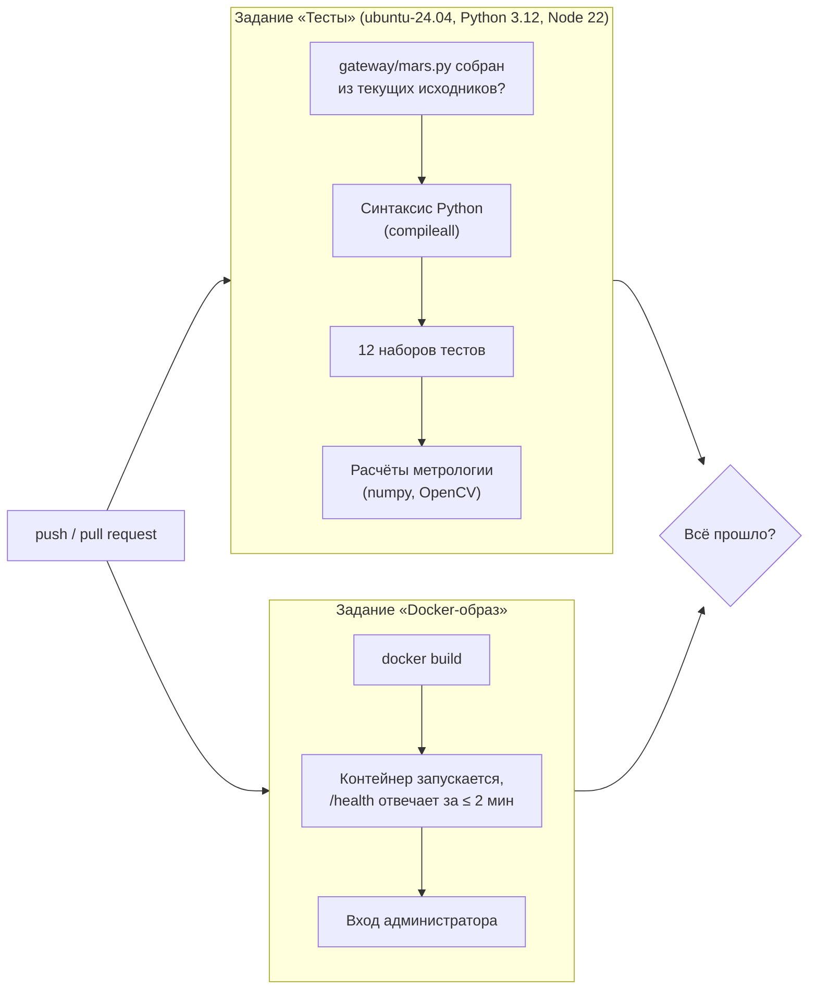

# 10. Тестирование и CI

## 10.1 Наборы тестов

18 наборов в `tests/`. Каждый запускается отдельно: `python tests/<имя>.py`. Тесты поднимают свой стенд на портах 18000+ во временной папке данных, поэтому рабочие данные не затрагиваются. Набор печатает `OK` или `FAIL` по каждой проверке и завершается с кодом 1 при любой ошибке.

| Набор | Что проверяет | Где запускается |
|---|---|---|
| `test_access` | Врач видит только своих пациентов; чужой неотличим от несуществующего; права на файлы | CI |
| `test_audit_quota` | Журнал аудита, ссылка врача и сессия, отчёт без расшифровки, лимиты загрузок, устаревшие задания | CI |
| `test_consent` | Согласие и отзыв согласия на речь, запись после завершения приёма, журнал assistant без данных | CI |
| `test_database` | gateway без SQL, все именованные запросы, миграции, резервные копии | CI |
| `test_fhir` | Экспорт в HL7 FHIR R4: структура, единицы UCUM, ссылки | CI |
| `test_gigachat` | Клиент GigaChat без сети: токен, повторы при 429, отказы, падежные формы | CI |
| `test_i18n` | У каждой строки интерфейса есть английский перевод | CI |
| `test_password_vendor` | Смена пароля, перебор, пароль администратора после перезапуска; SHA-256 файлов MediaPipe | CI |
| `test_repeat` | Повторяемость: среднее, SD, MDC95, CSV | CI |
| `test_report_marks` | Пометка «в пределах погрешности», индекс асимметрии подвижности | CI |
| `test_reports` | Заключение через reports и работа при его остановке | CI |
| `test_vision` | Метрики vision совпадают с расчётом браузера; очередь; отказ vision | CI |
| `test_metrology` | Статистика метрологии (Спирмен, AUC, ДИ Уилсона) и эталон деформации фантома | CI (numpy, OpenCV) |
| `test_resilience` | Запуск всех сервисов, `/status` при остановке каждого | Локально: нужны Whisper и Ollama |
| `test_failover` | Полный набор: каждый сервис по очереди, включая database и gateway | Локально |
| `test_speech` | Согласие, куски речи, Whisper, очередь, отказ speech | Локально: Whisper |
| `test_assistant` | Обезличивание на 20 + 10 диалогах (пороги заданы заранее), вкладка, отказ Ollama | Локально: Ollama (`--quick` — без 30 диалогов) |
| `test_parallel` | Разные пары расшифровываются параллельно: потоки на 3.14t, процессы на 3.12 | Локально: Whisper |

Вспомогательные файлы:
- `deid_dialogs.py` — 30 синтетических диалогов с разметкой личных данных;
- `eval_deid.py` — оценка обезличивания;
- `audio_tools.py` — подготовка звука;
- `js_face_harness.js` — запуск JS-кода анализа лица в Node для сравнения с Python.

## 10.2 Непрерывная интеграция (GitHub Actions)

Файл `.github/workflows/ci.yml` запускается на каждый push и pull request.

- **Проверка сборки** ловит частую ошибку: правку в `gateway/src/` без пересборки `gateway/mars.py`.
- Тесты с тяжёлыми моделями (Whisper около 500 МБ, Ollama около 2 ГБ) в CI не запускаются: их загрузка заняла бы больше времени, чем сами тесты. Перед коммитом их нужно запускать локально.
- Последний запуск: оба задания прошли (тесты и Docker-образ).

## 10.3 Как тестировались производительность и точность

| Что | Чем | Отчёт |
|---|---|---|
| Нагрузка 1–16 пар | `loadtest/run.py`, `loadtest/report.py` | [Производительность](performance.md) |
| Параллельная расшифровка | `loadtest/bench_transcribe*.py`, `tests/test_parallel.py` | [Производительность](performance.md#83-параллельная-расшифровка-процессы-и-потоки-python-314-без-gil) |
| Ollama против GigaChat | `loadtest/bench_llm.py`, `loadtest/run.py --llm` | [Производительность](performance.md#84-нейросеть-обезличивания-ollama-против-gigachat) |
| Точность метрик | `metrology/phantom.py`, `meei.py`, `meei_app.py`, `baseline.py` | [Метрология](metrology.md) |
