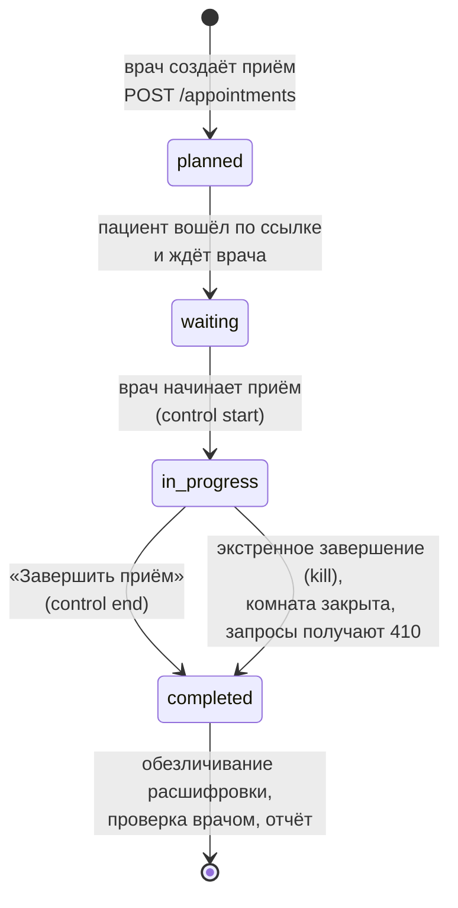
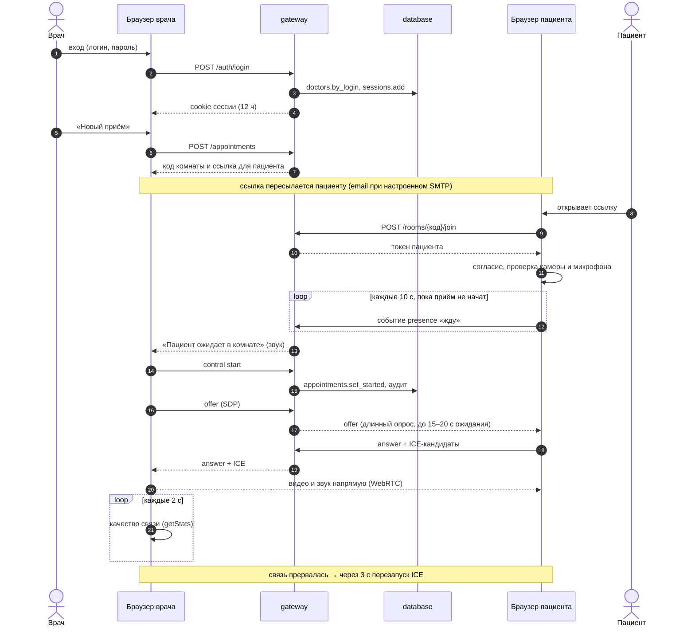
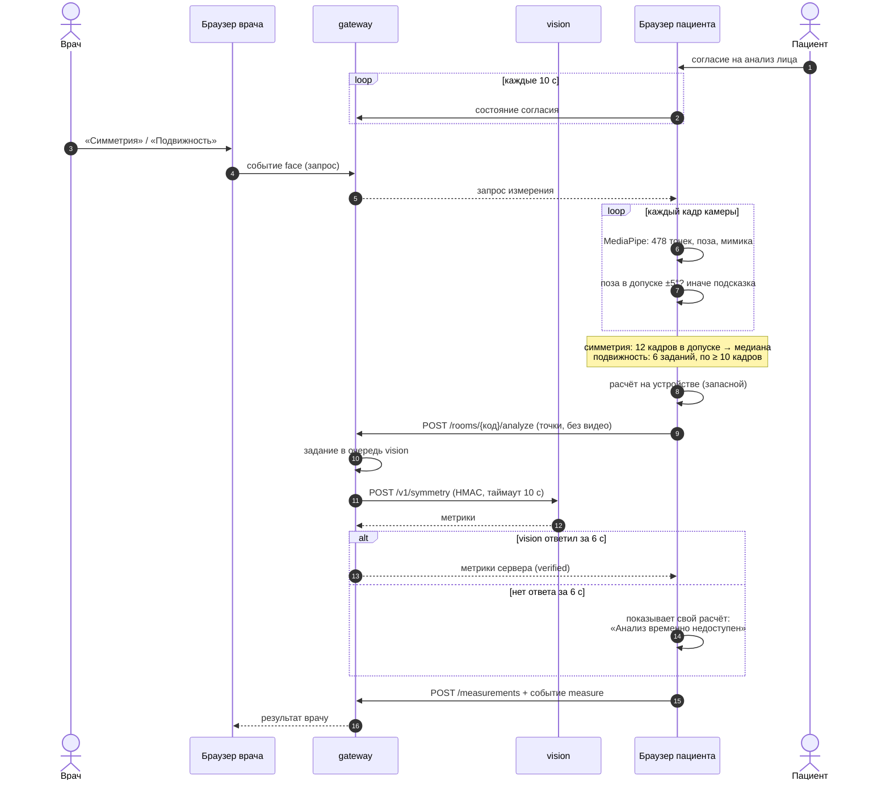
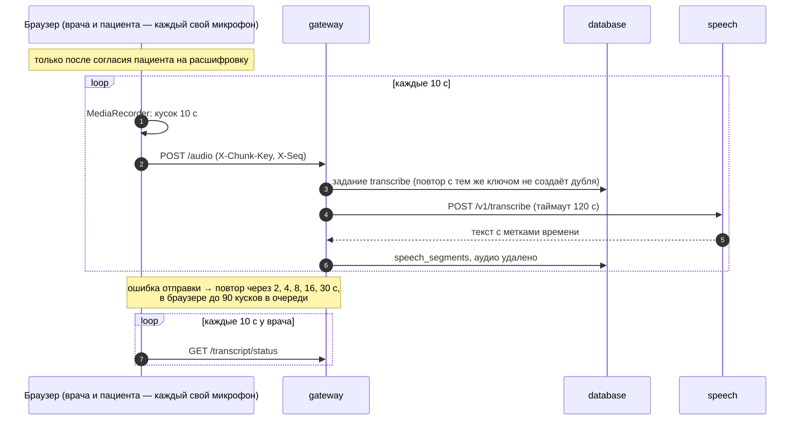
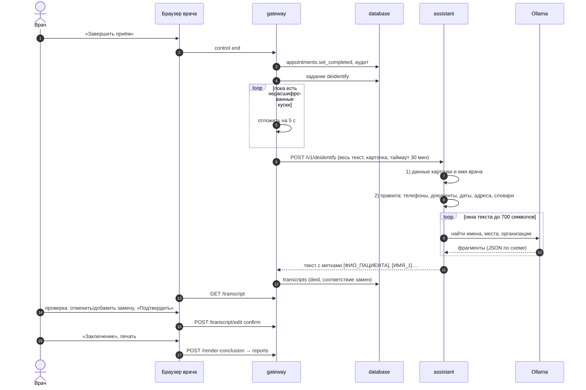
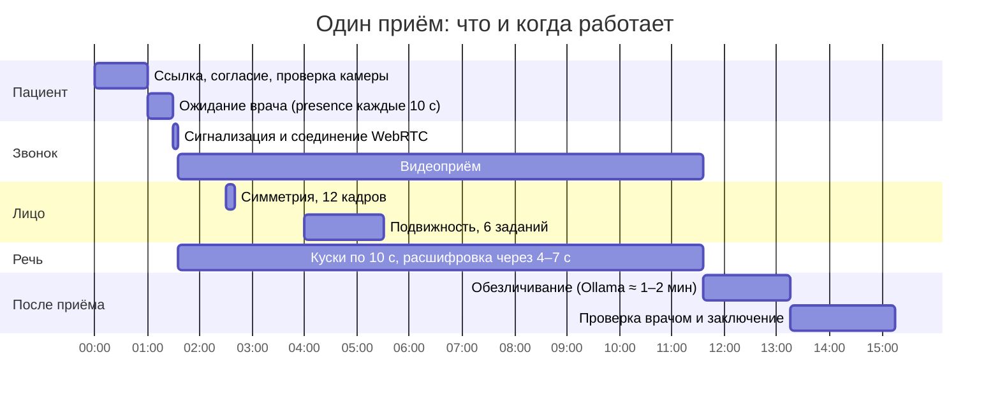

# 2. Сценарии и время

Раздел описывает, какая функциональность срабатывает в какой момент приёма. Все интервалы и таймауты взяты из кода, ссылки на файлы — в сводной таблице [2.6](#26-все-интервалы-и-таймауты).

## 2.1 Жизненный цикл приёма

Статусы хранятся в `appointments.status`: `planned`, `waiting`, `in_progress`, `completed`.

## 2.2 Начало приёма и видеосвязь

**Сигнализация** — это короткие сообщения о том, как соединиться: offer, answer, ICE. Они идут через gateway длинным опросом `GET /rooms/{код}/events?after=N&wait=15`: сервер держит запрос до 20 с и отвечает сразу, как только появится событие. На нагрузочном тесте доставка занимает 2–4 мс (p95). Сами видео и звук идут между браузерами напрямую. Если соединение напрямую невозможно, используется TURN-сервер (`TURN_URL`).

## 2.3 Измерение лица

## 2.4 Речь во время приёма

Куски разных пар расшифровываются одновременно: по умолчанию 2 исполнителя (`SPEECH_WORKERS`). Куски одной пары идут строго по порядку.

## 2.5 Завершение приёма, обезличивание, отчёт

## 2.6 Все интервалы и таймауты

### Браузер

| Что | Интервал / таймаут | Где |
|---|---|---|
| Длинный опрос событий комнаты | ждёт до 15 с (сервер ограничивает 20 с), при ошибке повтор через 1–10 с | `c_js2.js` (`Poller`) |
| Присутствие в комнате (presence) | каждые 10 с, пока приём не идёт или нет связи | `c_js2.js` |
| Качество связи (getStats) | каждые 2 с | `c_js2.js` (`Quality`) |
| Перезапуск ICE при обрыве | через 3 с после `disconnected` | `c_js2.js` (`Rtc`) |
| Обновление расписания приёмов | каждые 15 с | `c_js2.js` |
| Индикатор состояния сервисов (`/status`) | каждые 15 с | `c_js3.js` |
| Кусок речи | 10 с | `e_speech.js` (`CHUNK`) |
| Повтор отправки куска | 2, 4, 8, 16, 30 с; очередь до 90 кусков | `e_speech.js` |
| Обновление статуса расшифровки у врача | каждые 10 с | `e_speech.js` |
| Состояние согласия на анализ лица | каждые 10 с | `d_face2.js` |
| Ожидание ответа vision | 6 с, затем расчёт на устройстве | `d_face1.js` (`Remote.WAIT`) |
| Измерение симметрии | 12 кадров в допуске позы ±5°, медиана | `vision/metrics.py` (`SYM_NEED`) |
| Задание подвижности | ≥ 10 кадров в допуске ±10° | `vision/metrics.py` (`MOB_MIN_FRAMES`) |

### Сервер

| Что | Значение | Где |
|---|---|---|
| Сессия врача | 12 ч | `a1_core.py` (`SESSION_TTL`) |
| Повторная проверка сессии по базе | раз в 60 с; если база недоступна, действует до 10 мин | `a3_http.py` (`SESSION_RECHECK`, `SESSION_GRACE`) |
| Комната без активности удаляется | через 2 ч; не больше 50 комнат | `a1_core.py` (`ROOM_TTL`, `MAX_ROOMS`) |
| Фоновая уборка | раз в 60 с | `a2_data.py` (`cleanup_loop`) |
| Поток очереди сервиса просыпается | сразу при новом задании или раз в 1 с | `a6_jobs.py` |
| Таймаут задания: vision / speech / assistant | 10 с / 120 с / 30 мин | `a6_jobs.py` (`JOB_SERVICES`) |
| Повтор задания при отказе сервиса | 2, 4, 8, 16, 32, 60 с, дальше раз в 60 с; vision — до 20 попыток | `a6_jobs.py` |
| Обезличивание ждёт расшифровку | откладывается на 5 с, пока есть нерасшифрованные куски | `a6_jobs.py` |
| Невыполненное задание | через 24 ч помечается ошибкой, входные данные стираются | `a6_jobs.py` (`JOB_KEEP`) |
| Исходный текст расшифровки | хранится 30 дней | `a6_jobs.py` (`TRANSCRIPT_DAYS`) |
| Выключатель цепи | 3 ошибки подряд → пробный запрос раз в 10 с (в очереди — раз в 5 с) | `shared/client.py` |
| Допустимый сдвиг часов в HMAC-подписи | 60 с | `shared/security.py` |
| Резервная копия базы | каждые 24 ч и при запуске, если последней больше 24 ч; хранятся 14 копий | `database/main.py` (`BACKUP_HOURS`, `BACKUP_KEEP`) |
| Перезапуск упавшего сервиса | через 3 с (или 10 с, если он падает сразу после старта) | `run_all.py` |
| Токен GigaChat | 30 мин, обновляется за 1 мин до истечения | `assistant/gigachat.py` |

## 2.7 Временная шкала типичного приёма

Пример: одна пара, 10 минут разговора, локальная Ollama. Длительности расшифровки и обезличивания — из нагрузочного теста (1 пара): отставание текста от речи 4–7 с, обезличивание 66–138 с после завершения.

